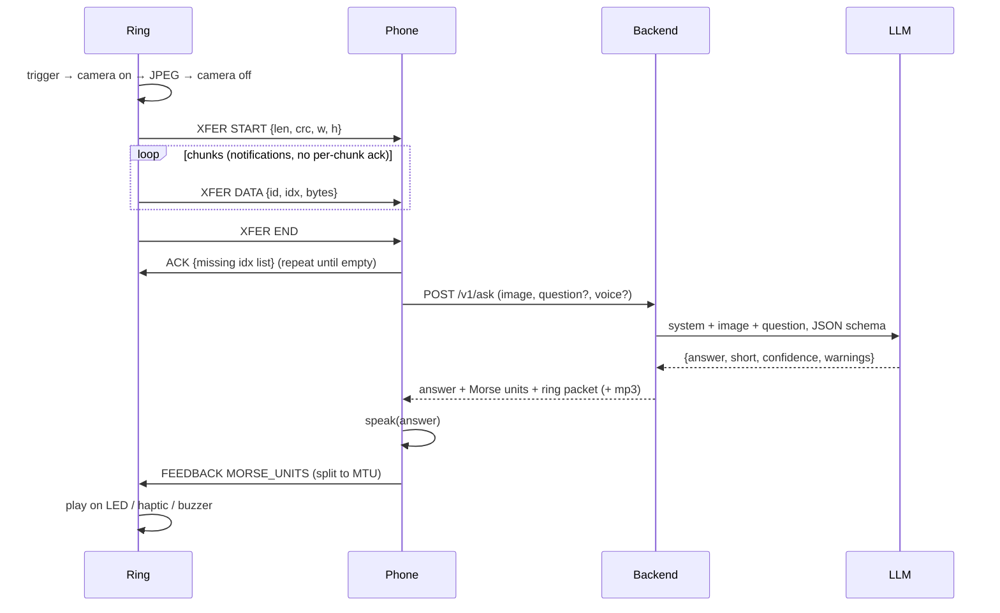
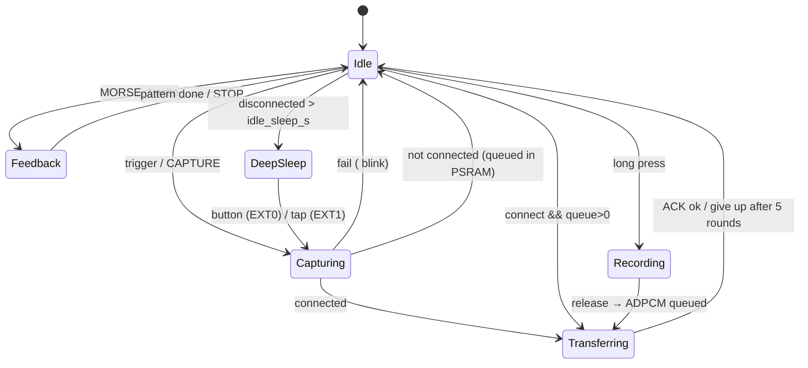

# System block diagrams

## End-to-end

```mermaid
flowchart LR
  subgraph Ring
    T[Trigger<br/>button · double-tap · touch] --> MCU[MCU<br/>ESP32-S3 (stage 0/1)<br/>nRF52840 (stage 2)]
    CAM[Camera<br/>OV2640 / HM01B0 / OVM7692] -->|DVP 8-bit JPEG or raw| MCU
    MIC[PDM mic] -->|PCM → ADPCM| MCU
    MCU -->|RTP on/off| HAP[DRV2605 + LRA]
    MCU --> LED[RGB LED]
    MCU --> BUZ[Piezo]
    MCU -.-> AUX[Aux: air puff (stage 1 experiment)]
    BAT[LiPo 16–40 mAh] --> PMIC[Charger + LDO/buck<br/>BQ25100 · load switch] --> MCU
  end
  MCU <-->|BLE GATT<br/>7a3b0001-…mcring| PHONE[Companion<br/>phone app / desktop CLI]
  PHONE <-->|HTTPS multipart<br/>POST /v1/ask| BE[Backend<br/>FastAPI]
  BE <-->|vision + structured JSON| LLM[Claude Opus 5.5<br/>(or OpenAI)]
  BE -.->|optional| TTS[TTS]
  PHONE -->|speech| EAR[Phone speaker / earbuds]
```

## Request sequence



## Firmware state machine


