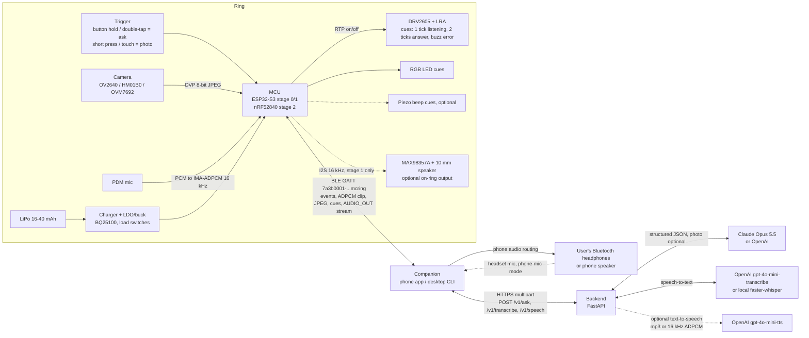
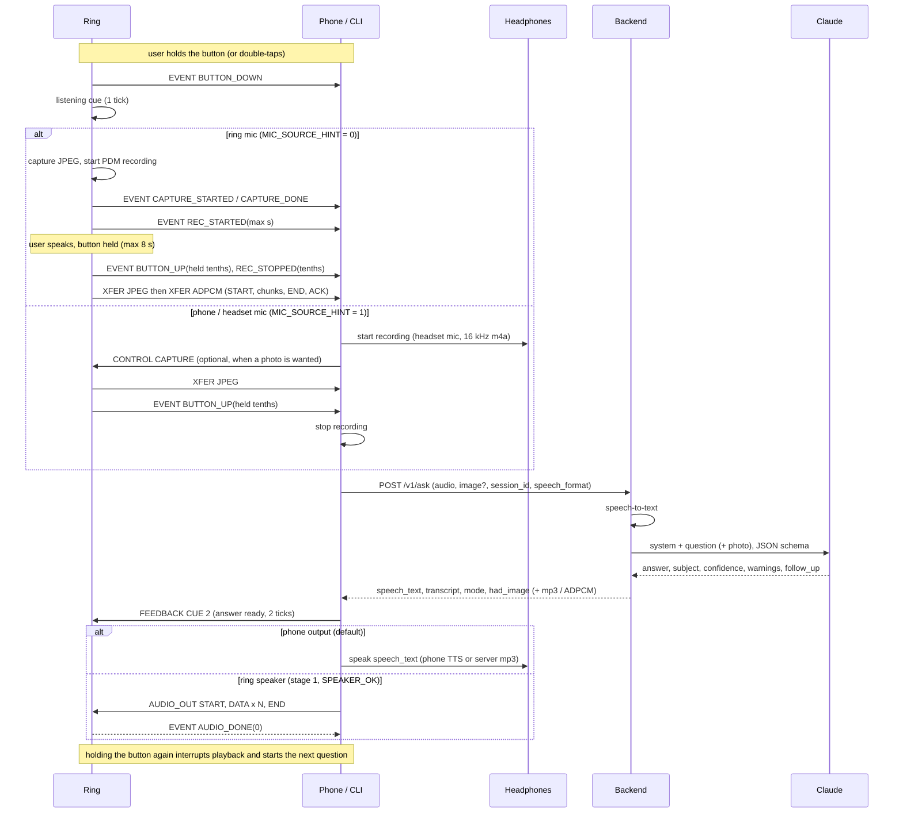
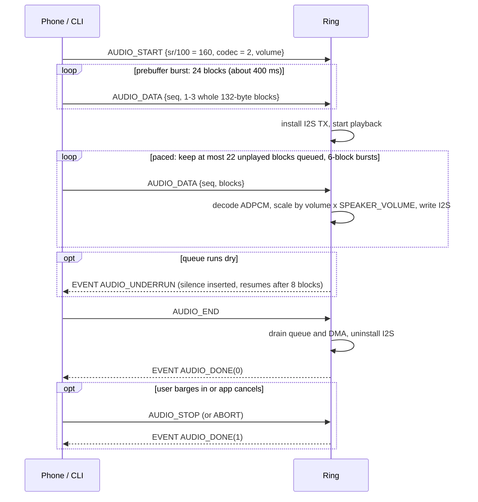
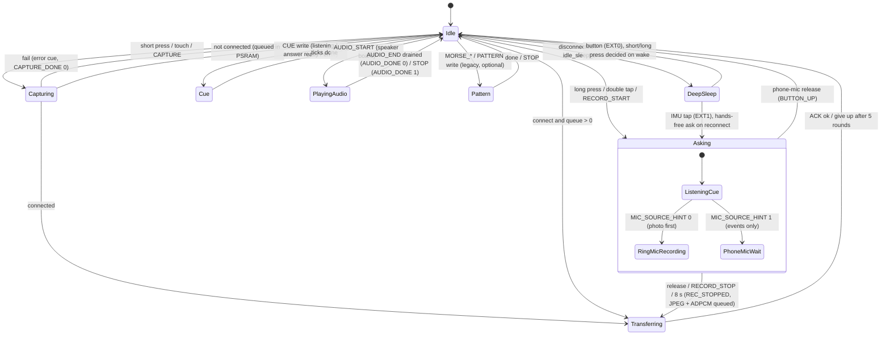

# System block diagrams

Voice-first: hold the ring → ask (ring mic or headset mic) → hear Claude in your headphones, or
from the on-ring speaker on the stage-1 oversized ring. The ring never pairs to headphones; the
phone routes all audio.

## End-to-end

## One voice turn

## Ring speaker streaming (AUDIO_OUT, stage 1)

## Firmware state machine

